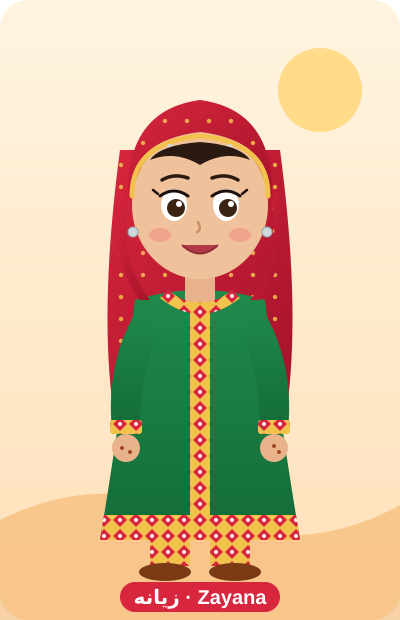

# زيانه · Zayana

زيانه شخصية كرتونية عمانية تعيش داخل Claude Code، لابسة الزي العماني التقليدي:
لحاف أخضر مورّد بحواف ذهبية وشراريب ملونة، دشداشة حمراء منقوشة بالذهبي والأخضر
مع صدرية مطرزة وذيل أزرق، سروال أخضر بأطراف مطرزة، تيكا وقلادة ذهب، وحذاء فضي.

## وين تلقاها في Claude Code؟
| المكان | الملف |
|---|---|
| ترحيب عند بداية كل جلسة (SessionStart hook) | `scripts/zayana.sh` |
| شريط الحالة تحت | `scripts/zayana-statusline.sh` |
| أسلوب الرد (Claude يتكلم بشخصية زيانه) | `.claude/output-styles/zayana.md` |
| الرسمة | `zayana.svg` / `zayana.png` |

كل شي مفعّل من `.claude/settings.json`. افتح Claude Code داخل هذا المجلد وبتطلع لك زيانه.
تقدر تغيّر الأسلوب أو توقفه بأمر `/config` → Output style.

جرّبها في الطرفية: `bash scripts/zayana.sh`
